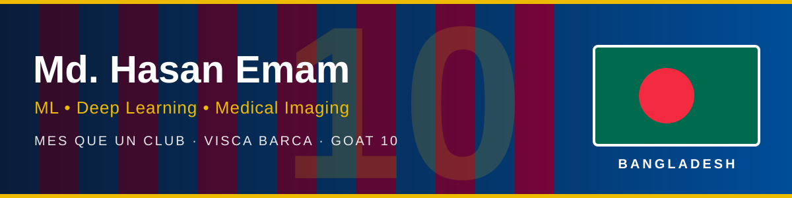

<!-- Barca x Messi x Bangladesh theme -->

  

  

  
  
  

---

## 🔵🔴 About Me

- 🎓 CSE graduate student at **North South University**
- 🧠 Working on **machine learning & deep learning for medical imaging**
- 🔬 Research: biomedical image retrieval, retinal disease classification, deep learning architectures
- ⚽ Culer to the core. **Messi** is the reason I love football
- 🇧🇩 From the land of rivers, Bangladesh

## 🛠️ Tech Stack

  
  
  
  
  
  
  

## 📊 GitHub Stats

  
  

  

## 🏆 Messi Mode

> *"You have to fight to reach your dream. You have to sacrifice and work hard for it."* — Lionel Messi

Same mindset for research: keep dribbling past bugs, keep scoring with results. ⚽

## 📫 Connect

  
  

  

