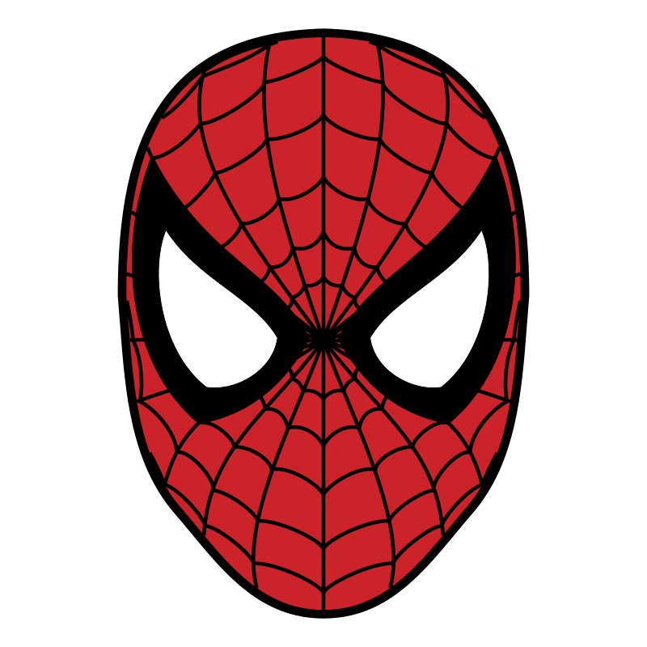

<!-- Barça x Messi x Bangladesh | Md. Hasan Emam -->

  

  

  
  
  
  

---

## ⚽ Player Card

<table>
  <tr>
    <td width="300" align="center" valign="top">
      
    </td>
    <td valign="top">

**Position:** ML Researcher · **Club:** North South University · **Kit:** No. 10

- 🎓 CSE graduate student at **North South University**
- 🧠 I build **machine learning & deep learning** models for **medical imaging**
- 🔬 Research: biomedical image retrieval, retinal disease classification, deep learning architectures
- 📈 Side quests: ML for time series, full-stack data apps
- ⚽ Culer to the core. Messi is the reason I fell in love with football
- 🇧🇩 Born and raised in the land of rivers, Bangladesh

Card stats (DL, CV, MED, PY, RES, TEAM) are just for fun.

</td>
  </tr>
</table>

## 🧭 Game Plan (Research Focus)

| Zone | What I work on |
|:--|:--|
| 🩻 **Medical imaging AI** | Deep learning for medical images: classification, retrieval and diagnostic support |
| 🧠 **Deep learning** | Designing, training and debugging modern vision architectures (CNNs, transformers, hybrids) |
| 📚 **Open to** | Research collaborations, reviews, and good football debates |

## 🛠️ Starting XI (Tech Stack)

| Line | Players |
|:--|:--|
| 🎯 **Forwards** (core ML) |    |
| 🎨 **Midfield** (data & vision) |     |
| 🛡️ **Defence** (workflow) |     |
| 🧤 **Goalkeeper** (foundations) |  |

## 🎬 Match Highlights

<!--START_SECTION:highlights-->
| Project | What it does |
|:--|:--|
| ⚽ [**stock-market-analytics-platform**](https://github.com/mdhasanemam/stock-market-analytics-platform) | Full-stack web platform for stock analytics: dashboard, ML predictions, model comparison, technical indicators, watchlist |
| 🎯 [**stock-price-prediction**](https://github.com/mdhasanemam/stock-price-prediction) | Stock price prediction with KNN, Random Forest, Bayesian regression, Decision Tree, Gradient Boosting and SVR |
<!--END_SECTION:highlights-->

This table refreshes automatically from my latest public repositories.

## 📊 Season Stats

  

<table align="center">
  <tr>
    <td align="center" width="50%">
      
    </td>
    <td align="center" width="50%">
      
    </td>
  </tr>
  <tr>
    <td align="center" width="50%">
      
    </td>
    <td align="center" width="50%">
      
    </td>
  </tr>
</table>

### 🐍 Contribution Snake

  <picture>
    <source media="(prefers-color-scheme: dark)" srcset="https://raw.githubusercontent.com/mdhasanemam/mdhasanemam/output/github-snake-barca-dark.svg"/>
    <source media="(prefers-color-scheme: light)" srcset="https://raw.githubusercontent.com/mdhasanemam/mdhasanemam/output/github-snake-barca.svg"/>
    
  </picture>

## 🏆 Messi Mode

> *"You have to fight to reach your dream. You have to sacrifice and work hard for it."*  
> — Lionel Messi

Research is a lot like a Messi run: patient, low to the ground, beating one bug at a time, and then suddenly the goal.

## 🇧🇩 

*আমার সোনার বাংলা, আমি তোমায় ভালোবাসি।*

Building from Dhaka, for the world. 🌍

## 📫 Connect

  
  

  
  
  
  

📧 **Email:** [hasanemamrabbi@gmail.com](mailto:hasanemamrabbi@gmail.com) · [hasan.emam@northsouth.edu](mailto:hasan.emam@northsouth.edu)  
🌐 **Portfolio:** [mdhasanemam.github.io](https://mdhasanemam.github.io/)  
🎓 **Google Scholar:** [Md. Hasan Emam](https://scholar.google.com/citations?user=UYvdcTkAAAAJ&hl=en)

  <b>Visca Barça 🔵🔴 · Messi 🐐 · Bangladesh 🇧🇩</b>

  

